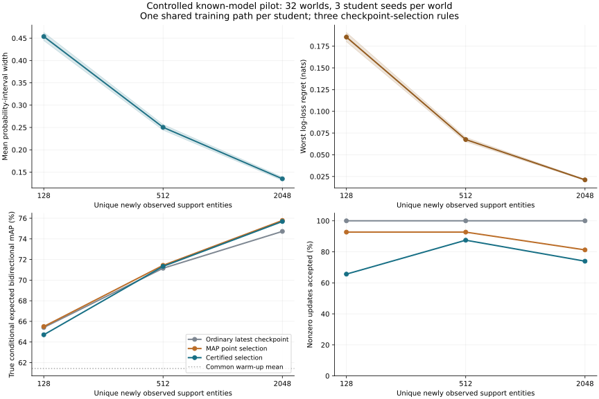

# 受控运行：证据区间收紧与 cosine 排序差值认证

日期：2026-11-10（北京时间）。**合成数据、已知正确生成模型、线性两塔学生；没有新增 NUS 训练。**

## 结论

证书已能与实际训练、真实 cosine 排序联动：32 个独立观测世界、每世界 3 个学生随机种子，共 96 条训练轨迹、14,784 次 Adam 更新。在 288 次部署决策中，认证规则接受了 218 次非零更新，真实条件期望 AP 下降 0 次。它没有陷入全部拒绝。

但是，最终认证选择的期望双向 mAP 为 75.68712%，比同候选池的 MAP 点估计选择 75.78492% 低 0.09779 个百分点。世界级配对差的近似 95% t 区间为 [-0.15607,-0.03952] 个百分点，32 世界中 0 胜、18 负、14 平。**当前结果支持认证的可计算性和非零改进验收，不支持平均性能优于点估计选择。**

所有统计量均来自以下未平滑原始记录，不把合成任务结果当作 NUS 的效果。

## 1. 固定协议与比较对象

- 32 个独立世界，每个世界独立生成 warm-up、支持流、图库与查询实体。
- 教师维度 3（截距加二维固定特征），正确二元 logistic 模型，真参数范数不超过事前固定 S=4，λ=1、δ=0.05。
- 128 个 warm-up 实体训练 5 轮。随后依次接收 128、512、2048 个独立支持实体；每个阶段用 warm-up 加当前支持前缀训练 3 轮。
- 3 个学生随机种子，每轮所有实体保留，batch=64，Adam lr=0.01。每个学生总步数 10+12+30+102=154。
- 每世界固定 64 个查询、128 个图库实体，双向全量 cosine 排序；不按置信度筛样本。
- 每阶段保存 3 个候选；普通规则取最新候选，点估计和认证规则分别按点估计期望差与保守差值下界选择。所有策略共享候选路径；选择不改变训练轨迹或 Adam 状态。
- 查询标签和 oracle 概率在该世界全部选择冻结后才用于计算下面的真实期望和已实现 AP。

固定配置：[config.json](config.json)。源文件哈希与版本：[run.json](run.json)。生成协议及实现说明：[模块说明](../../README.md)。

## 2. 概率区间与信息半径

| 独立支持实体数 | 平均概率区间宽度 | 平均信息半径（nats） | 认证接受非零更新 |
|---:|---:|---:|---:|
| 128 | 0.453740 | 0.185487 | 63 / 96 |
| 512 | 0.250341 | 0.067537 | 84 / 96 |
| 2048 | 0.135087 | 0.021124 | 71 / 96 |

128→2048 时平均宽度减少 70.23%，信息半径减少 88.61%。全部逐查询轨迹中，下界没有回落、上界没有上升、信息半径没有增加。这里的半径是最坏对数损失遗憾；不是原后验 EU。

32/32 世界在三个登记时点均保留真参数，全部固定查询的真类别概率也被区间包含。世界级同时覆盖估计的双侧 95% Clopper–Pearson 区间为 [89.11%,100%]。样本量不足以单凭这次零漏盖证明总体覆盖已达到 95%；覆盖依据仍是明确假设下的定理，模拟用于核验实现。

12,288 个端点优化中，22 次求解器未报告成功；实现仍使用可独立成立的解析对偶界，无端点回退到仅参数球界。原始候选点目标与对偶界最大差为 1.07044e-5。浮点保护量不是形式化区间算术证书。区间及数值诊断见 [bounds.jsonl](bounds.jsonl)。

## 3. 实际排序的收益与代价

下表是**真实条件期望双向 mAP**，通过已知生成概率在选择冻结后计算。它使用实际 cosine 排序，不是预测头的代理分数。

| 支持实体数 | 普通最新快照 | MAP 点估计选择 | 认证选择 |
|---:|---:|---:|---:|
| 128 | 65.40863% | 65.50318% | 64.70176% |
| 512 | 71.15224% | 71.43476% | 71.33703% |
| 2048 | 74.72561% | 75.78492% | 75.68712% |

共同 warm-up 起点的平均真实期望 mAP 为 61.43207%。较差的早期学生仍有明显学习空间，因此上述涨幅不应转述成对成熟 FUME 检查点的增益。

在最终阶段，认证选择比普通最新快照高 0.96151 个百分点，世界级配对 95% t 区间为 [0.35134,1.57169]；但它低于更有辨别力的 MAP 点估计选择。最终实际抽到的查询标签上的 mAP 分别为 74.59729%、75.67939%、75.62730%。

| 全过程计数 | 普通最新快照 | MAP 点估计选择 | 认证选择 |
|---|---:|---:|---:|
| 接受的非零更新 | 288 | 256 | 218 |
| 已接受更新中真实期望 AP 下降 | 34 | 0 | 0 |
| 已接受更新中实际查询 AP 下降 | 40 | 5 | 1 |

认证通过不保证每次抽到的有限查询标签上的 AP 都提高；那 1 次已实现下降与条件期望保证不矛盾。点估计规则本次也没有接受真实期望有害的更新，所以本轮尚未展示认证相对该规则的期望安全性优势。

认证候选比较中，有 749 个候选的真实期望差为正，其中 157 个未获得正证书，占 20.96%。这是可见的保守代价；候选相关，不能把这些条目当作 749 次独立试验。[逐次选择](decisions.jsonl) · [全部候选比较](attempts.jsonl) · [关键配对比较](critical_comparisons.json)

图上阴影为世界级近似 95% t 区间。性能曲线仅连结三个登记支持规模的原始均值，不做平滑。

## 4. 核验与可复跑性

- 模块 22 项测试通过，包含独立标量根、凸集合可行见证、LP 与通用求解器对照、FUME 逐式前向和中央差分梯度。
- 独立重算 960 份保存模型、2592 次候选比较、864 次策略选择、96 份前缀与区间、1344 条训练计数。
- 名义二类证书最大差 2.01e-16；保守证书与独立闭式加声明余量最大差 1.36e-15；AP 与增量最大差 4.44e-16。
- 条件性数学检查失败 0 次；全部候选的最大“证书下界减真实期望差”是 -0.00136747。
- 独立复算不重训、不重跑置信集合投影，不把它称为第二次训练复现。

[汇总结果](summary.json) · [独立复算记录](replay_verification.json) · [训练记录](training.jsonl) · [模型权重快照](models.jsonl) · [置信集合阈值](checkpoints.jsonl) · [初始模型](initial.jsonl) · [实体池哈希](manifest.jsonl) · [世界级审计](world_audit.jsonl)

所有 AP 原始值为 0–1；报告中的百分比及百分点均乘 100。均值区间先在每个世界内平均三个学生种子，再以 32 世界作为独立单位；不是按查询或 96 条学生路径计算独立样本区间。

## 5. 当前研究决定

保留这一模块作为已通过数值和受控训练核验的认证原型。现有数据未证明认证选择优于点估计选择，也未证明下界反馈改善 NUS 训练。原直接下界损失负结果和六组权重对照暂停状态保持。

当前主要实现仍是低维二元教师。真实 NUS 接入需要多类联合教师、正确的观测及查询条件、足够有用的高维集合；原配对测试不能直接套用这里的未来查询模型。具体访问事实与协议缺口见 [真实数据接入审查](../../REAL_DATA_INTAKE.md)。
