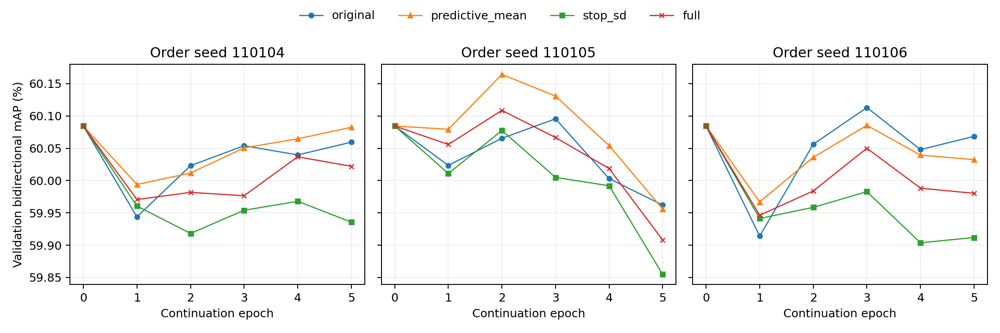

# NUS 下界反馈连续训练实测

从已登记的第 6 轮检查点出发，完成 4 组 × 3 个批次顺序种子 × 135 次 Adam 更新。共同起点的测试双向 mAP 为 58.9097%。主终点取续训第 5 轮。完整下界比共同起点高 0.0566 个百分点，但低于同条件原 FUME 续训 0.0642 个百分点，也低于后验均值监督 0.0964 个百分点。三组顺序种子的这两项差值方向一致。

## 固定第 5 轮

表中每个指标均取三个顺序种子的测试均值，顺序为 110104、110105、110106。每次评测保留全部 1,000 个查询及对应图库。

| 组别 | 入选轮次（种子顺序） | 图→文 % | 文→图 % | 双向 % | Brier | NLL | ECE | 正例匹配下界 | 负例不匹配下界 | AU | EU |
|---|---|---:|---:|---:|---:|---:|---:|---:|---:|---:|---:|
| 原 FUME 续训 | 5 / 5 / 5 | 58.9453 | 59.1156 | 59.0305 | 0.0661 | 0.2419 | 0.0369 | 0.3793 | 0.8941 | 0.1611 | 0.0069 |
| FUME＋后验均值 | 5 / 5 / 5 | 58.9016 | 59.2238 | 59.0627 | 0.0708 | 0.2496 | 0.0451 | 0.4417 | 0.8764 | 0.1676 | 0.0079 |
| FUME＋停止标准差梯度下界 | 5 / 5 / 5 | 58.6737 | 59.2178 | 58.9458 | 0.0783 | 0.2814 | 0.0581 | 0.4971 | 0.8689 | 0.1505 | 0.0084 |
| FUME＋完整下界 | 5 / 5 / 5 | 58.7729 | 59.1597 | 58.9663 | 0.0725 | 0.2558 | 0.0475 | 0.4595 | 0.8757 | 0.1671 | 0.0072 |

标准差参与反传使完整下界相对停止其梯度的版本提高 0.0205 个百分点，3 胜 0 负。后验均值相对原 FUME 提高 0.0322 个百分点，3 胜 0 负。与后验均值相比，完整下界的 Brier、NLL、ECE 分别高 0.00164、0.00625、0.00246，三个种子的三项评分均变差。

## 各组按验证 mAP 选轮

候选轮次为 0 至 5，轮次 0 是共同起点。先固定全部 12 组的选择，再评测测试集。

| 组别 | 入选轮次（种子顺序） | 图→文 % | 文→图 % | 双向 % | Brier | NLL | ECE | 正例匹配下界 | 负例不匹配下界 | AU | EU |
|---|---|---:|---:|---:|---:|---:|---:|---:|---:|---:|---:|
| 原 FUME 续训 | 0 / 3 / 3 | 59.0293 | 59.0741 | 59.0517 | 0.0654 | 0.2406 | 0.0351 | 0.3733 | 0.8948 | 0.1631 | 0.0068 |
| FUME＋后验均值 | 0 / 2 / 3 | 58.9105 | 59.2222 | 59.0664 | 0.0667 | 0.2409 | 0.0380 | 0.3942 | 0.8889 | 0.1665 | 0.0071 |
| FUME＋停止标准差梯度下界 | 0 / 0 / 0 | 58.6554 | 59.1640 | 58.9097 | 0.0645 | 0.2411 | 0.0323 | 0.3601 | 0.8965 | 0.1664 | 0.0066 |
| FUME＋完整下界 | 0 / 2 / 0 | 58.7447 | 59.2225 | 58.9836 | 0.0656 | 0.2413 | 0.0349 | 0.3772 | 0.8931 | 0.1667 | 0.0067 |

同一个起点和支持库限制了结论的适用范围，三个种子只刻画批次顺序变化。概率上下界和 AU/EU 均来自模型近似，真实逐对覆盖率未测。

## 原始曲线与数值



- [每步训练损失与两塔末层梯度范数](training.csv)，[每轮验证指标](validation.csv)，[测试原始终点](final.csv)。
- [逐种子配对差值](summary/per_seed.csv)，[双向及单方向百分点差、胜负和极值](summary/paired_summary.csv)，[各组验证选轮](selections.json)。
- [训练配置与输入哈希](run_manifest.json)，[共同起点与 Adam 初态](branch_starts.json)，[实际训练日志](console.log)，[完成状态](status.json)。

## 复跑与核验

训练器固定于 [1bbd4bc](https://github.com/XinchengSun/fume-bound-feedback/tree/1bbd4bcf92925f10116f3fba95c648bde1ffb3a5/fume_bounds/feedback_training)。在项目根目录，使用已登记的输入和该版本解释器环境，按下式运行。三个数值库线程环境变量与实际启动一致，训练器使用 CPU 及 3 个 Torch 线程。

```bash
OPENBLAS_NUM_THREADS=1 OMP_NUM_THREADS=3 MKL_NUM_THREADS=3 \
python -u fume_bounds/feedback_training/run.py all \
  --checkpoint "$CHECKPOINT" --dataset "$NUS_H5" --out "$NEW_OUTPUT"
```

在本记录目录运行 `python check_records.py` 可独立核查样本顺序、初态、全部更新、验证选择、双向 mAP 和逐种子差值。加 `--plot` 可从原始 CSV 重画图。输入数据、特征和模型权重保存在受控服务器，Git 中提供重放入口及小型实测记录。
