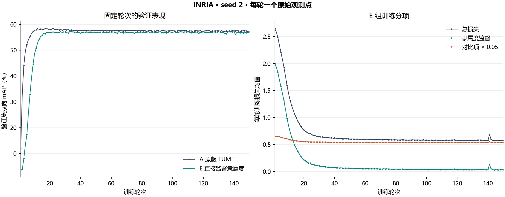

# INRIA E 组实际运行记录

E 组直接用完整标签监督隶属度 m = ReLU(zW)，固定第 150 轮权重进行全查询余弦检索。训练提交 [bbd3b6f](https://github.com/XinchengSun/fume-bound-feedback/tree/bbd3b6fe66d47a65ec1b31a9b8149ce55ecda5de/fume_bounds/v5/minimal_supervision)。GPU1、seed 2、每批 300、固定 lr 5e-5，完成 4,500 次 Adam 更新。数据、双塔和 W 初值、150 轮训练样本顺序已与 A 核对。[核验回执](verification.json) · [运行配置与源码哈希](provenance.json)

| 第 150 轮测试，4,366 个查询／方向 | 图像→文本 | 文本→图像 | 双向平均 |
|---|---:|---:|---:|
| A 原版 FUME | 55.9746% | 57.8296% | 56.9021% |
| B 普通 BCE | 5.9220% | 3.2457% | 4.5839% |
| E 直接监督隶属度 | 55.2771% | 57.0841% | 56.1806% |

E−A 为 −0.7215 个百分点，E−B 为 +51.5968 个百分点。[E 最终测试回执](test_metrics.json) · [五组测试结果 CSV](final_test_map.csv) · [训练完成记录](completion.json)

## 实际启动入口

2026-11-07，执行端在高优双卡作业 job-ecb844ba-8556-40b0-b386-257ad322d9ed 的 worker-0 调用以下命令。完整的物理 GPU1 包装器调用、解释器、数据与输出路径、require-ab150 和 final-test 参数均保留在[原始启动脚本](launch_E.sh)。[Worker 标准输出](worker.log)记录了实际可见 GPU 的 UUID 和逐轮运行情况。

~~~sh
sh /inspire/ssd/project/video-generation/public/sunxincheng/FUME/local_ops/E_seed2_20261107/launch_E.sh
~~~

## 分项损失、梯度与曲线

- [训练 JSONL](history.jsonl) 含 150 轮总损失、隶属度监督损失、原始与乘以 0.05 后的对比损失、实际学习率、样本数及耗时。监督项是两模态各自的逐样本欧氏距离均值之和。
- [梯度 JSONL](gradient_probe.jsonl) 含每轮首批图像塔和文本塔最后线性层权重的监督梯度范数、加权对比梯度范数和二者夹角余弦。每组范数只覆盖所标明的层与批次。
- [逐轮验证 JSONL](validation.jsonl) 与[更新前验证](initial_validation.json)使用 1,332 个验证查询；测试单独使用末轮权重。[150 轮顺序哈希](order.jsonl)可与 [A 组顺序](../20261107_ab150/runs/A_fume/order.jsonl)逐行核对。
- [合并原始 CSV](E_raw_epochs.csv) 含两方向验证 mAP、A/E 验证双向平均、E 的训练分项与梯度。CSV 的 mAP 单位为百分数，原始 JSONL 和 test_metrics.json 为 0 到 1。[曲线 PNG](E_raw_curves.png)逐点绘制各轮实际均值。[原执行端绘图和核验脚本](verify_E.py)保留了运行时本地目录约定。

12 份服务器原始文件的字节已在归档时重新核验。[SHA256 清单](server_files.sha256) · [服务器测试日志](pytest.log) · [解析机制检查](mechanism_cpu.json)
